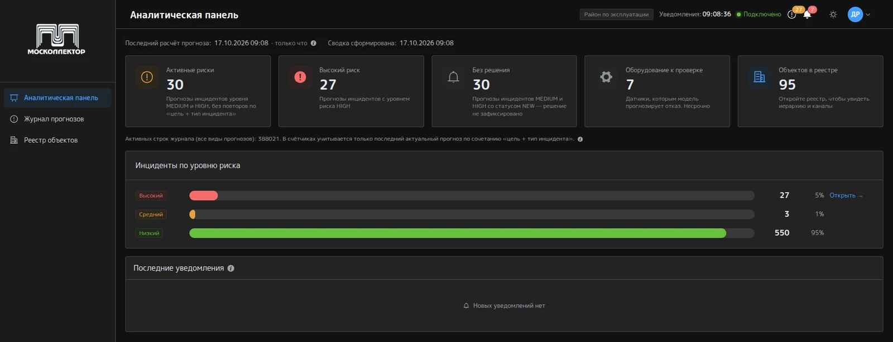
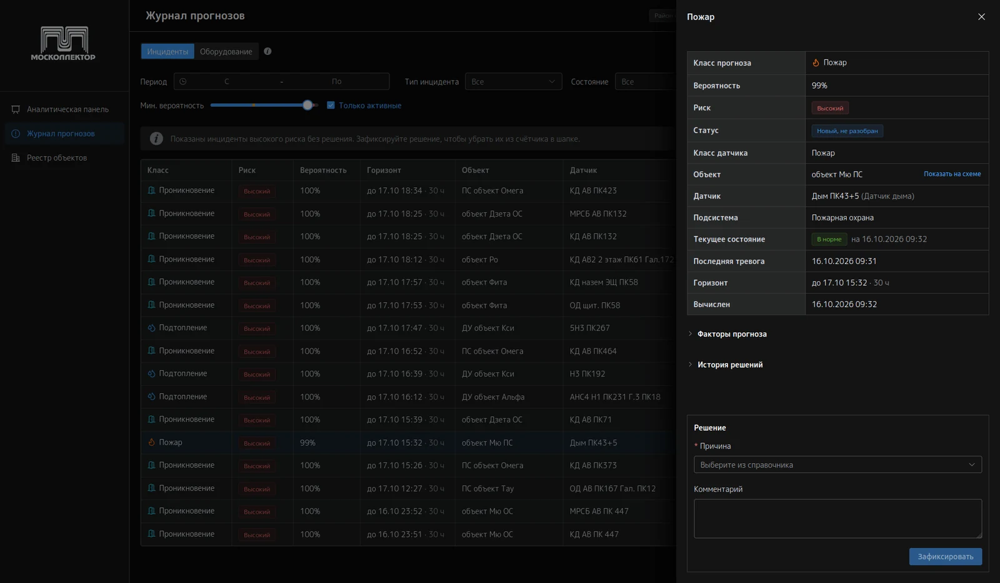
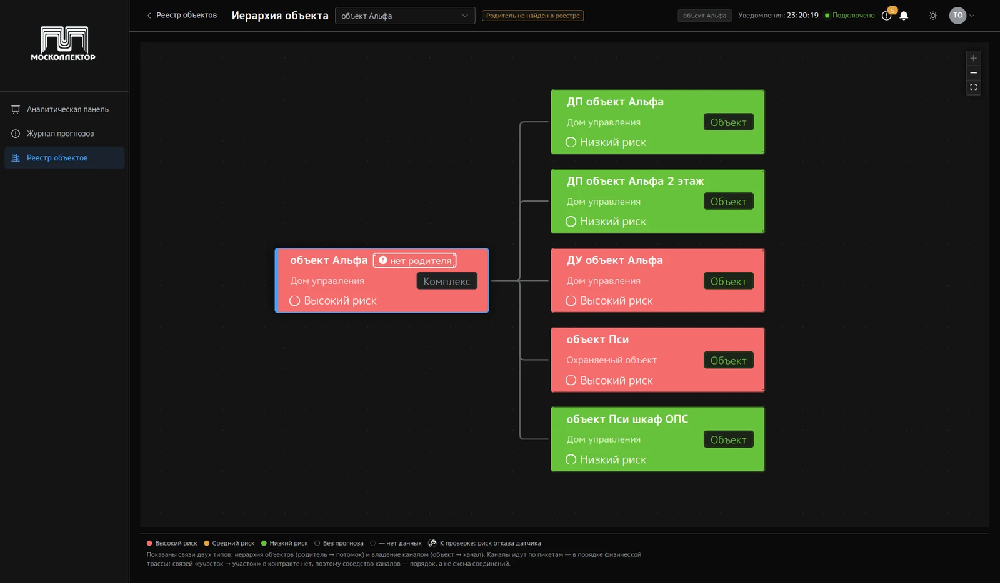
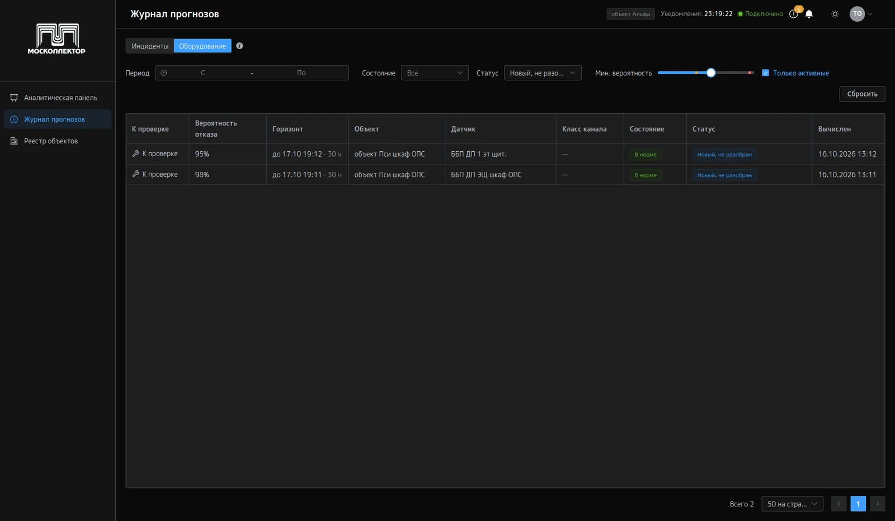
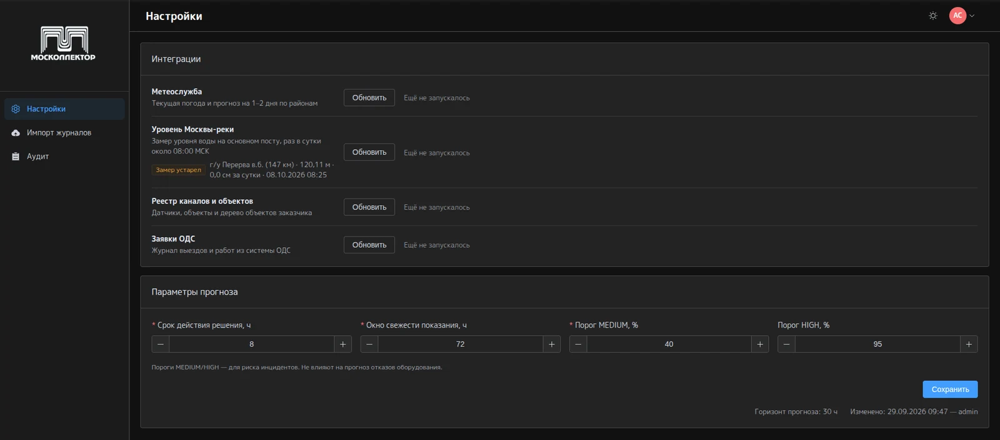
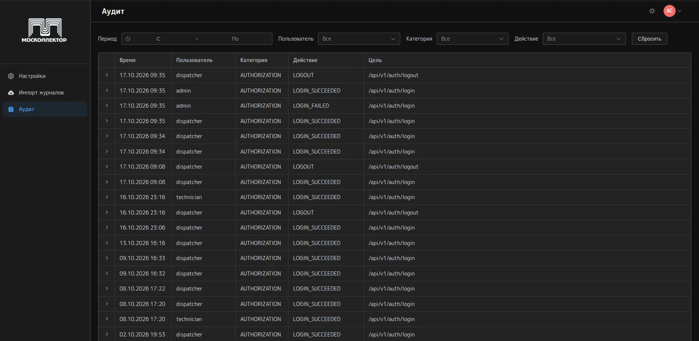

<div align="center">

# Интерфейс «Москоллектор»

Веб-интерфейс диспетчерского стенда: прогноз инцидентов в коллекторах Москвы
и отказов датчиков, разбор прогнозов и фиксация решений.

[](https://vuejs.org/)
[](https://vite.dev/)
[](https://www.typescriptlang.org/)
[](https://element-plus.org/)

[Стенд](https://moscollector-goal.ru) ·
[Команда /goal](https://github.com/hack-goal-team) ·
[Архитектура интерфейса](docs/architecture.md)

</div>

Хакатон ЛЦТ 2026, кейс 8. Заказчик — Департамент ЖКХ города Москвы и
АО «Москоллектор». Интерфейс показывает готовые прогнозы, которые бэкенд
читает из журнала инференса; модель напрямую клиент не вызывает.

<p align="center">
  
  <br>
  <sub>Аналитическая панель: сводка рисков, распределение инцидентов по уровням
  риска, последние уведомления</sub>
</p>

## Возможности

- **Аналитическая панель** — счётчики активных рисков, высокого риска и
  прогнозов без решения, карточка «Оборудование к проверке», лента последних
  уведомлений.
- **Журнал прогнозов** — вкладки «Инциденты» и «Оборудование» (прогноз
  отказов датчиков), фильтры по периоду, типу инцидента, состоянию и
  минимальной вероятности, карточка прогноза с факторами и историей решений.
- **Реестр и иерархия объектов** — граф объекта, узлы окрашены по уровню
  риска, отдельный значок отмечает датчик в зоне риска отказа.
- **Уведомления в реальном времени** — поток SSE о критических прогнозах:
  тосты, индикатор в шапке, переход в карточку прогноза.
- **Светлая и тёмная тема.**

Что доступно пользователю, определяют права его роли; область видимости
(поддерево объектов) бэкенд проверяет в каждом запросе.

| Роль                  | Что делает в интерфейсе                                          |
| --------------------- | ---------------------------------------------------------------- |
| Техник                | Смотрит прогнозы, иерархию объектов и оборудование к проверке    |
| Диспетчер района, ЦДС | Разбирает прогнозы и фиксирует решение с причиной из справочника |
| Руководитель          | Смотрит прогнозы и сводку; раздел отчётов пока заглушка          |
| Администратор         | Загрузка журнала, параметры и пороги риска, интеграции, аудит    |

Маршруты и права подробно — в [docs/architecture.md](docs/architecture.md).

## Скриншоты

<table>
  <tr>
    <td colspan="2">
      
      <p align="center"><sub>Журнал прогнозов: инциденты высокого риска без
      решения и карточка прогноза с классом, вероятностью, горизонтом,
      факторами и формой решения</sub></p>
    </td>
  </tr>
  <tr>
    <td width="50%">
      
      <p align="center"><sub>Иерархия объекта: граф узлов с цветом риска
      (роль «Техник»)</sub></p>
    </td>
    <td width="50%">
      
      <p align="center"><sub>Вкладка «Оборудование»: датчики к проверке по
      прогнозу отказов</sub></p>
    </td>
  </tr>
  <tr>
    <td colspan="2" align="center"><b>Администратор</b></td>
  </tr>
  <tr>
    <td width="50%">
      
      <p align="center"><sub>Настройки: ручное обновление интеграций
      (метеослужба, уровень Москвы-реки, реестр каналов и объектов, заявки
      ОДС) и параметры прогноза — срок действия решения, окно свежести
      показания, пороги риска MEDIUM и HIGH</sub></p>
    </td>
    <td width="50%">
      
      <p align="center"><sub>Аудит: журнал входов и действий пользователей
      с фильтрами по периоду, пользователю, категории и действию</sub></p>
    </td>
  </tr>
</table>

## Быстрый старт

Нужны Node.js 20.x (LTS) и npm 10.x.

```bash
npm ci
cp .env.template .env.local
npm run dev
```

Приложение откроется на [http://localhost:5173/](http://localhost:5173/).
Шаблон окружения включает MSW, поэтому интерфейс работает без бэкенда.

<details>
<summary>Установка Node.js</summary>

**Windows:** скачать LTS с
[https://nodejs.org/en/download](https://nodejs.org/en/download),
установить, проверить:

```bash
node -v   # v20.x.x
npm -v    # 10.x.x
```

**Linux/macOS:** через nvm или пакетный менеджер.

</details>

## Окружение

Скопировать `.env.template` в `.env.local`. Шаблон включает MSW для автономной
демонстрации. Для подключения к запущенному бэкенду задайте:

```bash
VITE_API_URL=/api/v1
VITE_USE_MOCK=false
VITE_API_TARGET=http://localhost:8080
```

**Моки:** при `VITE_USE_MOCK=true` MSW перехватывает запросы к `/api/v1/*`
только в режиме разработки. При `VITE_USE_MOCK=false` Vite проксирует `/api/*`
на `VITE_API_TARGET`. Переменная `VITE_API_TOKEN` из шаблона клиентом не
используется: авторизация работает через cookie-сессию. Секреты нельзя
размещать в переменных `VITE_*`: они попадают в клиентскую сборку.

## Проверки

```bash
npm run lint
npm run typecheck
npm run format:check
npm run test:run
```

Состав тестов зависит от текущей версии репозитория. `npm run build` также
выполняет проверку типов (`vue-tsc -b`).

## Сборка для продакшена

```bash
npm run build
```

Результат — папка `dist/`.

### Локальная проверка сборки

```bash
npm run preview
```

Сервер: [http://localhost:4173/](http://localhost:4173/)

<details>
<summary>Деплой на Nginx</summary>

1. Скопировать `dist/*` на сервер (например, в `/var/www/app/`).
2. Настроить Nginx:

   ```nginx
   server {
       listen 80;
       server_name your-domain.com;
       root /var/www/app;
       index index.html;
       location /api/ {
           proxy_pass http://backend:8080;
       }
       location / {
           try_files $uri $uri/ /index.html;
       }
   }
   ```

3. Проверить и перезагрузить:

   ```bash
   sudo nginx -t
   sudo systemctl reload nginx
   ```

</details>

Для SSE `/api/v1/notifications/stream` на прокси следует отключить
буферизацию ответа. Пример конфигурации стенда — `backend/deploy/nginx-frontend.conf`.
Бэкенд публикует Swagger на `/swagger-ui.html` и JSON на `/v3/api-docs`.
Контракт интерфейса хранится в `backend/docs/openapi-frontend.yaml`.
YAML содержит и проектные договорённости; фактически доступные маршруты
проверяйте по запущенному API.
